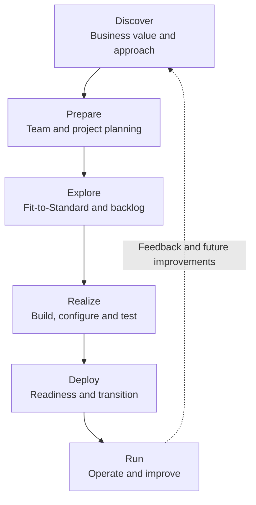
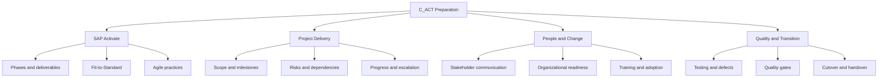
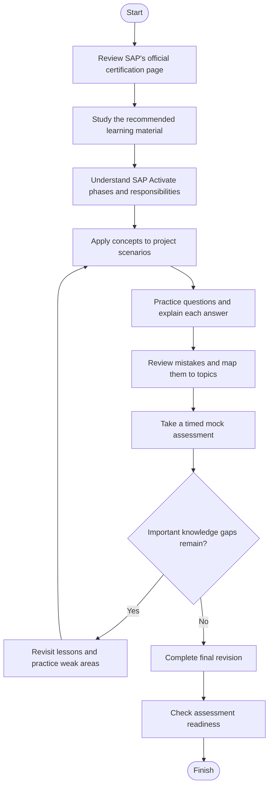
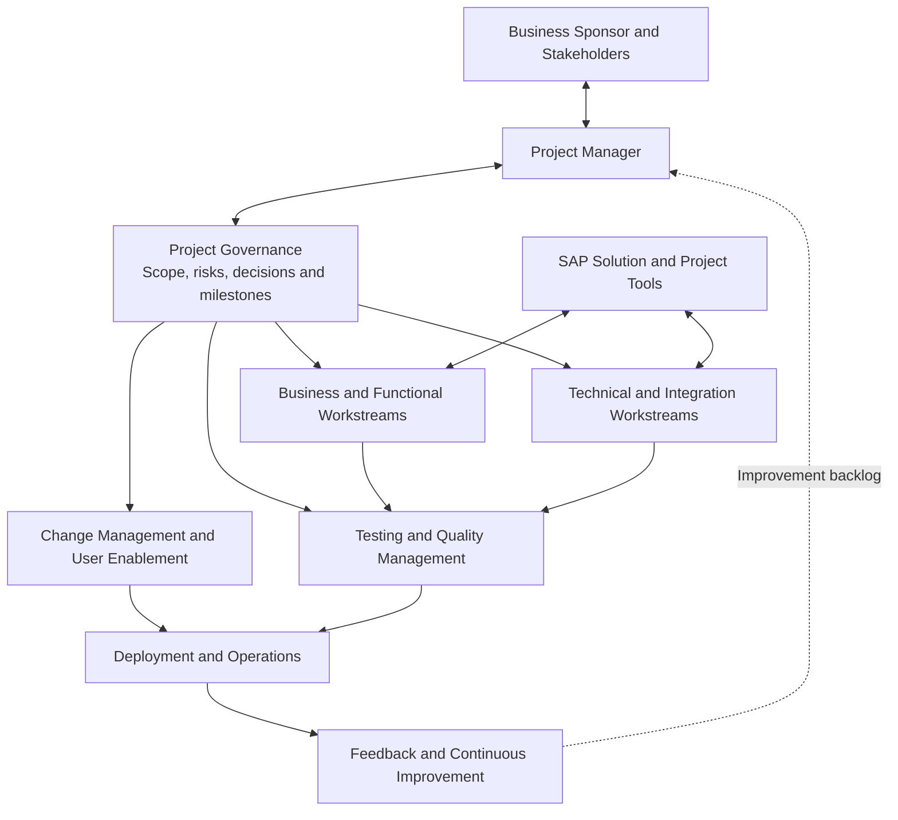
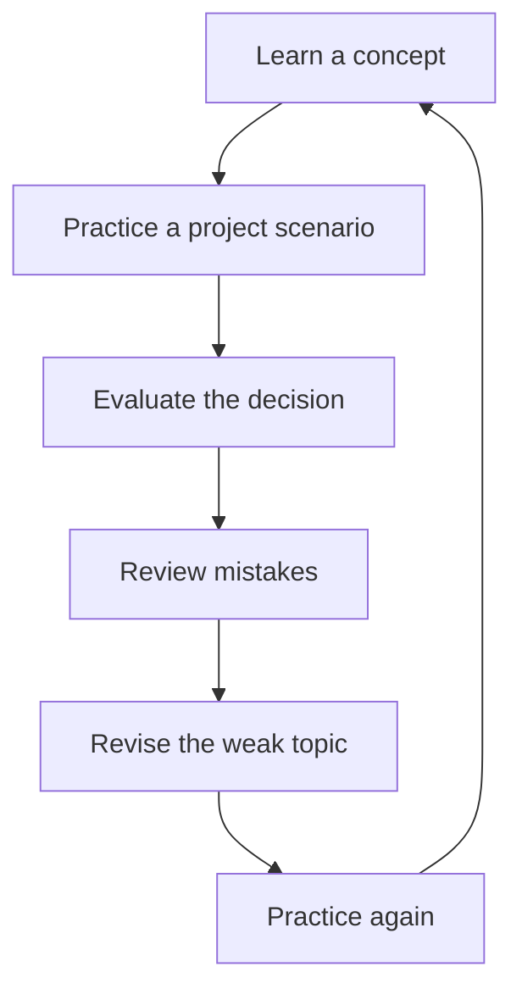
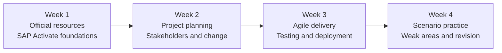

# SAP Activate Project Manager (C_ACT) — Study Guide

A structured, practical study guide for the **SAP Certified – Project Manager – SAP Activate (C_ACT)** certification. This repository helps learners understand SAP Activate, organize project implementation activities, strengthen project management judgment, and prepare for SAP's scenario-based assessment.

Whether you are an aspiring SAP project manager, an implementation consultant, or an experienced professional building your SAP delivery skills, use this guide alongside SAP's official learning resources and practical project scenarios.

**Exam preparation resource:** [CertsGate — SAP C_ACT](https://certsgate.com/exams/sap/c_act)

---

## Table of Contents

- [About the Certification](#about-the-certification)
- [Who Should Prepare?](#who-should-prepare)
- [Exam Information](#exam-information)
- [Core Knowledge Areas](#core-knowledge-areas)
- [SAP Activate Methodology](#sap-activate-methodology)
- [Conceptual Skills Map](#conceptual-skills-map)
- [Preparation Flowchart](#preparation-flowchart)
- [Project Delivery Architecture](#project-delivery-architecture)
- [Circular Study Cycle](#circular-study-cycle)
- [Step-by-Step Study Guide](#step-by-step-study-guide)
- [Suggested Study Roadmap](#suggested-study-roadmap)
- [Practice Questions and Mock Tests](#practice-questions-and-mock-tests)
- [Practical Project Exercises](#practical-project-exercises)
- [Common Preparation Mistakes](#common-preparation-mistakes)
- [Career Relevance](#career-relevance)
- [Frequently Asked Questions](#frequently-asked-questions)
- [Official and Additional Resources](#official-and-additional-resources)
- [About CertsGate](#about-certsgate)
---

## About the Certification

The **SAP Certified – Project Manager – SAP Activate** certification focuses on project management capabilities in SAP implementation environments. SAP describes the certification as validating business skills such as communication, stakeholder management, change management, successful project transitions, testing, and quality management, with an emphasis on the SAP Activate methodology.

SAP Activate provides a structured approach to SAP solution implementation. It brings together implementation guidance, SAP Best Practices, guided configuration, and Agile practices to help project teams plan and deliver solutions in manageable stages.

For project managers, understanding the methodology is only part of the challenge. They must also coordinate people, manage expectations, recognize delivery risks, support decisions, and maintain quality throughout the project lifecycle.

**Official certification page:**  
https://learning.sap.com/certifications/sap-certified-associate-project-manager-sap-activate-1

## Who Should Prepare?

This C_ACT study guide may be useful for:

- Project managers working on SAP implementation or transformation projects.
- SAP consultants who want to improve their project delivery knowledge.
- Implementation team leads coordinating business and technical workstreams.
- Professionals involved in stakeholder communication, change management, testing, and deployment.
- Learners preparing to move into SAP project management responsibilities.

Experience with project planning, teamwork, business processes, or enterprise software implementations can make the concepts easier to understand. Review SAP's official learning recommendations to determine the appropriate starting point for your background.

---

## Exam Information

The following information is based on the SAP certification page reviewed for this guide.

| Item | Published information |
|---|---|
| Certification name | SAP Certified – Project Manager – SAP Activate |
| Exam code | C_ACT |
| Certification provider | SAP |
| Assessment type | Scenario Based |
| Duration | 2 hours |
| Published pass score | 60% |
| Recommended learning | Discovering SAP Activate – Implementation Tools and Methodology |

**Version note:** CertsGate lists the certification as `C_ACT_2601`. SAP's public certification page identifies the exam as `C_ACT`. Confirm the currently available version and assessment instructions directly with SAP before scheduling your exam.

Official source: [SAP certification page](https://learning.sap.com/certifications/sap-certified-associate-project-manager-sap-activate-1)

SAP identifies the assessment as scenario-based. This makes it sensible to prepare by applying concepts to realistic project situations rather than relying exclusively on memorized definitions. The official page should be consulted for current registration, subscription, technical setup, and assessment policies.

---

## Core Knowledge Areas

Preparation should connect SAP Activate concepts with the responsibilities of a project manager. Use the topics below as an **independent study checklist**, not as an official exam-domain list or a statement of exam weightings.

| Knowledge area | What to understand |
|---|---|
| SAP Activate methodology | Project phases, objectives, deliverables, and phase transitions |
| Project planning and execution | Scope, milestones, dependencies, resources, and delivery tracking |
| Stakeholder management | Communication, expectation setting, escalation, and decision-making |
| Change management | Organizational readiness, user engagement, training, and adoption |
| Agile delivery | Iterations, backlogs, prioritization, reviews, and feedback |
| Testing and quality management | Test planning, defect handling, acceptance, and quality gates |
| Deployment and transition | Production readiness, cutover coordination, and handover |
| Risk and issue management | Identification, impact assessment, mitigation, ownership, and follow-up |

As you study, connect each concept to a project decision. For example, knowing what a risk register is matters, but you should also be able to explain when a risk needs escalation, who owns the response, and how progress should be communicated.

## SAP Activate Methodology

SAP Activate uses six main phases to structure implementation work.

| Phase | Main purpose |
|---|---|
| Discover | Explore the solution, business value, scope, and implementation approach |
| Prepare | Establish the project, organize the team, and finalize initial plans |
| Explore | Validate requirements and solution fit; identify gaps and prioritize work |
| Realize | Configure and build the solution through planned iterations, testing, and review |
| Deploy | Prepare the production environment, confirm readiness, and transition to operations |
| Run | Operate, monitor, support, and continuously improve the solution |

The precise activities and deliverables depend on the solution, deployment approach, and applicable roadmap. Use SAP's official materials to study the details relevant to your learning path.

### Visual: SAP Activate Project Lifecycle

The lifecycle is structured, but project learning does not stop at go-live. Operational feedback and evolving business needs can inform future improvements and releases.

---

## Conceptual Skills Map

SAP's public certification page does not provide a domain-percentage breakdown in the information used for this guide. The diagram below organizes useful preparation themes without implying official exam weighting.

Use this map to identify subjects that need more study. It is a learning aid, not an official SAP exam blueprint.

---

## Preparation Flowchart

A disciplined C_ACT preparation plan should combine official learning, scenario analysis, practice, and repeated review.

The important decision point is whether you can explain your reasoning. A high practice score alone is not enough if you cannot justify a project decision or identify why another option is less appropriate.

---

## Project Delivery Architecture

The following conceptual diagram illustrates how project management activities, implementation teams, and supporting tools work together. It is an educational model rather than a mandatory SAP project structure.

### How to interpret the diagram

- **Governance** gives the project team a way to make decisions, monitor risks, and track progress.
- **Business and technical workstreams** coordinate functional requirements, configuration, integration, and delivery tasks.
- **Testing and quality management** provide evidence that the solution meets agreed expectations.
- **Change management** prepares users and the organization for new processes and responsibilities.
- **Deployment and operations** coordinate readiness, transition, support, and ongoing improvement.

SAP's learning materials introduce tools such as SAP Cloud ALM in relevant implementation contexts. The tools used on an actual project depend on the solution, deployment model, and organizational setup.

---

## Circular Study and Revision Cycle

C_ACT preparation works best as a repeating process. Read a concept, apply it to a scenario, evaluate your understanding, and return to the material whenever your reasoning reveals a gap.

Do not move on just because you have completed a lesson. Move on when you can explain the concept in your own words and apply it to a realistic project situation.

---

## Step-by-Step Study Guide

### Step 1: Review the official certification information

Start with the [SAP C_ACT certification page](https://learning.sap.com/certifications/sap-certified-associate-project-manager-sap-activate-1).

Check the assessment type, duration, published pass score, and current learning recommendations. Review any assessment-specific instructions before registering.

### Step 2: Learn the SAP Activate phases

Build a simple set of notes for Discover, Prepare, Explore, Realize, Deploy, and Run. For each phase, record:

- Its main purpose.
- Typical project activities.
- Important outputs or deliverables.
- Risks that may affect progress.
- Decisions needed before moving forward.

Avoid treating the phases as isolated vocabulary. Focus on why an activity belongs in a particular phase and how its outcome supports the next stage.

### Step 3: Strengthen project management fundamentals

Review project scope, milestone planning, resource coordination, dependencies, risk ownership, issue escalation, and status reporting.

Consider a scenario in which an integration dependency is delayed. Think through how the project manager should assess the schedule impact, communicate with stakeholders, assign follow-up actions, and document the decision.

### Step 4: Understand Agile delivery and Fit-to-Standard

Study how SAP Activate uses standard processes and iterative delivery. Understand how requirements and gaps can be identified, prioritized, and managed through a backlog.

Practice explaining when a team should evaluate an existing standard process before proposing a customization. Consider business value, fit, effort, risk, and long-term maintenance.

### Step 5: Study change management and communication

Implementation projects affect people as well as systems. Review organizational readiness, stakeholder engagement, user training, adoption planning, and communications.

For each scenario, identify the stakeholders, the information they need, the timing of communication, and the best way to address resistance or uncertainty.

### Step 6: Connect testing, quality, and deployment

Learn how testing, defect management, acceptance, quality checks, and production readiness fit together. Think about what evidence a project team should review before approving a transition.

For example, a critical defect near go-live should trigger impact assessment, ownership, escalation, and a decision based on readiness criteria—not an automatic assumption that the schedule must take priority.

### Step 7: Practice scenario-based reasoning

After reviewing a topic, answer practice questions and explain why the chosen response best fits the situation. Review incorrect answers and revisit the corresponding official learning material.

For supplementary practice, explore [CertsGate's C_ACT preparation page](https://certsgate.com/exams/sap/c_act). Use third-party materials to test your understanding, not as a replacement for official SAP resources.

### Step 8: Assess readiness

Complete a timed practice session under realistic conditions. Review the results by topic, revisit weak areas, and repeat the process.

You should be able to explain the reasoning behind your answers, connect decisions to project outcomes, and distinguish between immediate action and longer-term prevention.

---

## Suggested Study Roadmap

This is a flexible four-week example, not an official SAP study duration. Adjust the schedule according to your existing experience and the time you can commit.

| Week | Study focus | Suggested output |
|---|---|---|
| 1 | Certification requirements and SAP Activate | Phase summary and personal study checklist |
| 2 | Planning, governance, communication, and change | Sample project plan and stakeholder map |
| 3 | Backlog management, quality, testing, and transition | Scenario notes and a basic risk register |
| 4 | Practice questions, mock assessment, and revision | Weak-area list and readiness review |

A simple daily routine could include reviewing one concept, applying it to a scenario, answering a small set of practice questions, and writing down any mistakes that reveal a knowledge gap.

---

## Practice Questions and Mock Tests

Practice questions can help identify knowledge gaps, but the value comes from reviewing the reasoning behind each answer.

Use this process:

1. **Answer:** Choose the option that best addresses the scenario.
2. **Explain:** State why the choice is appropriate.
3. **Compare:** Consider why the other options are weaker or introduce additional risk.
4. **Map:** Link the mistake to an SAP Activate concept or project management skill.
5. **Revise:** Return to the relevant official learning material.
6. **Retry:** Attempt a similar scenario without relying on memorized wording.

### Original practice scenarios

These are illustrative learning exercises created for this repository. They are not official SAP exam questions.

**Scenario 1: Requirements and solution fit**

During an SAP implementation, a business stakeholder requests a customization before the team has evaluated the standard process. What is the most appropriate next step?

- A. Approve the customization immediately to protect the schedule.
- B. Evaluate the standard process with stakeholders, assess the requirement, and document any justified gap.
- C. Defer all requirements until after go-live.
- D. Allow each workstream to make its own decision without coordination.

**Suggested answer: B.** A structured Fit-to-Standard discussion helps the team understand the business need, assess the available standard functionality, and determine whether a genuine gap requires further work.

**Scenario 2: A deployment readiness concern**

A critical defect remains unresolved shortly before a planned go-live. What should the project manager do first?

- A. Ignore the defect because the deployment date is already announced.
- B. Ask the team to remove it from the issue log.
- C. Assess the impact, obtain the relevant technical and business input, and escalate the readiness decision through the agreed governance process.
- D. Automatically cancel the project.

**Suggested answer: C.** A responsible readiness decision requires evidence, impact assessment, clear ownership, and appropriate stakeholder involvement.

**Scenario 3: Low user adoption**

Testing is progressing, but business users are not confident about the new processes. Which response best addresses the problem?

- A. Focus only on technical defects.
- B. Increase communication, identify user concerns, and coordinate targeted training and adoption activities.
- C. Assume adoption will improve automatically after go-live.
- D. Remove users from the testing process.

**Suggested answer: B.** Successful implementation involves organizational readiness as well as technical delivery.

### How to use a mock test

- Take it in a quiet environment and use the official assessment duration as a reference.
- Avoid looking up answers while completing the session.
- Review both incorrect answers and correct answers that required guessing.
- Group mistakes by topic to identify recurring gaps.
- Repeat practice after revisiting the relevant learning materials.

You can use [CertsGate C_ACT practice resources](https://certsgate.com/exams/sap/c_act) as an additional knowledge-check option. Confirm that any third-party resource matches the certification version you intend to take.

---

## Practical Project Exercises

You do not need to administer a live SAP implementation to develop project management judgment. Use a fictional implementation project to practice planning, communication, and decision-making.

### Exercise 1: Create a milestone plan

Draft a high-level plan for an organization implementing an SAP solution. Include the six SAP Activate phases, major milestones, dependencies, responsible roles, and approval points.

**Goal:** Explain how each milestone supports delivery and why delays in one workstream may affect others.

### Exercise 2: Build a risk register

Create a small register containing these fields:

| Field | Example |
|---|---|
| Risk | Business users may not be available for testing |
| Impact | Testing and acceptance could be delayed |
| Owner | Assigned workstream or business lead |
| Mitigation | Agree on testing dates and confirm user availability early |
| Trigger | Required participants have not confirmed availability |
| Follow-up | Review the risk at the next project checkpoint |

The example is illustrative. Adapt the risk, owner, and response to the circumstances of your scenario.

### Exercise 3: Prepare a stakeholder communication plan

List the sponsor, project team, business process owners, technical leads, and end users. Define what each group needs to know, how frequently they should receive updates, and how urgent decisions will be escalated.

### Exercise 4: Run a go-live readiness review

Prepare a checklist covering critical defects, testing evidence, data readiness, user training, operational support, cutover responsibilities, and stakeholder approval.

**Goal:** Practice making a readiness recommendation based on evidence and risk rather than schedule pressure alone.

### Exercise 5: Conduct a lessons-learned review

After completing your fictional project scenario, identify what went well, what created delays, which risks were missed, and what should change in the next release.

---

## Common Preparation Mistakes

**Memorizing phase names without understanding decisions**

Learn the purpose of each phase, its outputs, and how it relates to the next phase.

**Studying methodology without project management context**

Connect SAP Activate to scope, communication, dependencies, risk management, and stakeholder decisions.

**Ignoring change management**

A technically correct solution can still face adoption problems if users are not prepared for new processes.

**Treating every request as a customization**

Understand why Fit-to-Standard discussions help evaluate business requirements against standard capabilities.

**Practicing without reviewing mistakes**

Record why an answer was wrong, which concept was misunderstood, and what you need to study again.

**Relying on third-party practice material alone**

Use official SAP learning resources as the foundation. Supplementary practice can help you check understanding, but it cannot replace learning the methodology and applying it to realistic situations.

**Assuming one mock score guarantees readiness**

Look for consistent reasoning across different scenarios, including questions involving uncertainty, competing priorities, risks, and communication.

---

## Career Relevance

SAP Activate project management knowledge is relevant to professionals involved in enterprise software implementation, business transformation, and delivery coordination.

The concepts covered in this guide can support work such as:

- Coordinating implementation teams and workstreams.
- Planning project milestones and dependencies.
- Communicating with stakeholders and managing expectations.
- Supporting change management and organizational readiness.
- Tracking quality, risks, issues, and deployment readiness.
- Facilitating continuous improvement after go-live.

The certification can help demonstrate relevant knowledge, but career outcomes depend on factors such as practical experience, role requirements, communication skills, and the needs of individual employers.

---

## Frequently Asked Questions

### What is the SAP C_ACT certification?

It is the SAP Certified – Project Manager – SAP Activate certification. SAP describes it as validating project management capabilities, including communication, stakeholder and change management, project transitions, testing, and quality management in SAP-related projects.

### How long is the C_ACT assessment?

The SAP certification page reviewed for this guide lists a duration of **2 hours**. Check the official page again before your assessment in case requirements change.

### What is the published passing score?

The reviewed SAP certification page lists a **60% pass score**. Always verify the current value directly with SAP before taking the assessment.

### Is the C_ACT assessment scenario-based?

Yes. SAP currently describes the assessment as scenario-based. Preparing to evaluate realistic project situations is therefore a useful study approach.

### Where should I start studying?

Begin with SAP's official certification page and the recommended [Discovering SAP Activate – Implementation Tools and Methodology](https://learning.sap.com/learning-journeys/discovering-sap-activate-implementation-tools-and-methodology) learning journey.

### Are the diagrams in this README official SAP exam diagrams?

No. They are independent educational diagrams intended to explain methodology phases, study planning, and project coordination. Consult SAP documentation for official methodology guidance.

### Can practice questions replace official SAP training?

No. Use practice questions to check your understanding and locate weak areas. Official SAP learning materials should remain the primary source for certification preparation.

### How should I decide whether I am ready?

You should be able to explain SAP Activate phases, reason through project scenarios, understand stakeholder and change management considerations, and justify decisions involving testing, risks, quality, and deployment. Practice results are useful feedback, not a guarantee of a particular exam outcome.

---

## Official and Additional Learning Resources

Use official SAP resources to confirm certification requirements and build a reliable foundation.

| Resource | Purpose |
|---|---|
| [SAP C_ACT Certification](https://learning.sap.com/certifications/sap-certified-associate-project-manager-sap-activate-1) | Current certification details, assessment information, and recommended preparation |
| [Discovering SAP Activate – Implementation Tools and Methodology](https://learning.sap.com/learning-journeys/discovering-sap-activate-implementation-tools-and-methodology) | SAP Activate methodology foundation, implementation workstreams, tools, and transition approaches |
| [Discovering SAP Activate – Agile Project Delivery](https://learning.sap.com/learning-journeys/discovering-sap-activate-agile-project-delivery) | Agile and Scrum concepts, backlog management, iterative delivery, and testing activities |
| [SAP Activate Community](https://community.sap.com/topics/activate) | SAP Activate discussions, community knowledge, and related content |
| [SAP Activate Roadmap Viewer](https://go.support.sap.com/roadmapviewer/) | Implementation roadmaps and supporting project guidance, subject to access |
| [CertsGate C_ACT Preparation](https://certsgate.com/exams/sap/c_act) | Independent supplementary preparation and practice resources |

SAP may update its certification portfolio, learning paths, and assessment requirements. Review the official links periodically and confirm that the content you use is relevant to your intended exam version.

---

## About CertsGate

[CertsGate](https://certsgate.com/) is an independent IT certification preparation resource covering multiple technology vendors and certification tracks.

For learners preparing for C_ACT, the [SAP C_ACT page](https://certsgate.com/exams/sap/c_act) can be used as a supplementary place to explore available practice material and check knowledge after studying the official methodology.

A productive preparation routine is to learn a concept from SAP's resources, apply it to a project scenario, use practice questions to identify gaps, and return to the original material to review mistakes. This keeps practice connected to genuine understanding.

---
